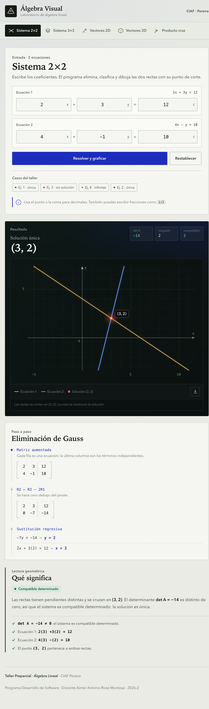

# Álgebra Visual

**Laboratorio visual de álgebra lineal** para resolver, explicar y graficar sistemas de ecuaciones y vectores. Proyecto del **Taller Preparcial** de Álgebra Lineal, programa **Desarrollo de Software**, **CIAF Pereira**, 2026-2. Docente: **Aimer Antonio Rivas Montoya**.

La aplicación funciona sin conexión a internet y no usa librerías externas: todo el cálculo, el dibujo y la interfaz están escritos en HTML, CSS y JavaScript puro.

**Demo en línea:** <https://juandaniel3108.github.io/gaus-jordan/>



---

## 1. Qué hace

| Módulo | Qué resuelve | Qué muestra |
| --- | --- | --- |
| **Sistema 2×2** | Dos ecuaciones con dos incógnitas por eliminación de Gauss | Clasificación, determinante, pasos, sustitución regresiva, verificación y dos rectas con su intersección |
| **Sistema 3×3** | Tres ecuaciones con tres incógnitas por eliminación de Gauss | Matriz en cada paso, rango, determinante, solución única o paramétrica, y tres planos en 3D con punto o recta común |
| **Vectores 2D** | Suma, resta, escalar, norma, producto punto, ángulo y área | Flechas, paralelogramo, ángulo y desarrollo algebraico |
| **Vectores 3D** | Las mismas operaciones en el espacio | Escena 3D giratoria con ejes, vectores y paralelogramo |
| **Producto cruz** | u × v por determinante 3×3 | Desarrollo del determinante, verificación de perpendicularidad, áreas y volumen opcional |

Todos los módulos incluyen:

- Entrada validada con mensajes claros en español.
- Procedimiento paso a paso con notación matemática.
- Interpretación geométrica redactada.
- Gráfica o escena 3D.
- Casos del taller precargados con un clic.
- Descarga del gráfico como PNG.

---

## 2. Cómo ejecutar

### Opción rápida (macOS)

Haz doble clic en **`iniciar.command`**. El script inicia un servidor local, elige un puerto libre y abre la aplicación en el navegador.

> La primera vez, macOS puede pedir confirmación para abrir el archivo. También puedes ejecutarlo desde Terminal con `./iniciar.command`.

### Opción manual

Desde la carpeta del proyecto:

```bash
cd "solucionador-visual"
python3 -m http.server 8080
```

Abre <http://localhost:8080> en el navegador.

También puedes usar:

```bash
npm run serve
```

**Importante:** no abras `index.html` con doble clic. La aplicación usa módulos ES (`<script type="module">`) y los navegadores bloquean su carga desde `file://` por seguridad. Por eso se necesita el servidor local, aunque no haya internet.

### Requisitos

- Python 3 (incluido en macOS y en la mayoría de distribuciones Linux), o Node.js para `npm run serve`.
- Un navegador actual: Chrome, Edge, Firefox o Safari recientes.
- No hay que instalar dependencias ni ejecutar `npm install`.

### Pruebas automáticas

```bash
cd "solucionador-visual"
npm test
```

Resultado esperado: **18 pruebas aprobadas**. Requiere Node.js 18 o superior.

---

## 3. Capturas de los casos de prueba

Las capturas se generaron ejecutando cada caso en la aplicación. Están en la carpeta [`docs/`](docs/).

| Caso | Ejercicio | Resultado esperado | Captura |
| --- | --- | --- | --- |
| CP1 | 1 | Solución única `(3, 2)`, `det A = −14` | [cp1-unica.jpg](docs/cp1-unica.jpg) |
| CP1 | 3 | Incompatible: rectas paralelas | [cp1-sin-solucion.jpg](docs/cp1-sin-solucion.jpg) |
| CP1 | 4 | Infinitas soluciones: `x = 4 + 2t, y = t` | [cp1-infinitas.jpg](docs/cp1-infinitas.jpg) |
| CP2 | 5 | Solución única `(2, 3, −1)`, `det A = −1` | [cp2-unica.jpg](docs/cp2-unica.jpg) |
| CP2 | 7 | Infinitas soluciones: `x = 3 − t, y = 1 − t, z = t` | [cp2-infinitas.jpg](docs/cp2-infinitas.jpg) |
| CP3 | 8 | Incompatible: `rango(A) = 2`, `rango([A\|b]) = 3` | [cp3-incompatible.jpg](docs/cp3-incompatible.jpg) |
| CP4 | 10 | Suma `(2, 4)`, resta `(−6, −2)`, `3p = (−6, 3)` | [cp4-vectores2.jpg](docs/cp4-vectores2.jpg) |
| CP4 | 13 | Suma `(5, 3, −1)`, resta `(−3, 3, −3)` | [cp4-vectores3.jpg](docs/cp4-vectores3.jpg) |
| CP5 | 15 | `a × b = (3, −9, −12)`, área `√234 ≈ 15,297` | [cp5-cruz.jpg](docs/cp5-cruz.jpg) |
| CP5 | 18 | Vectores paralelos: `u × v = (0, 0, 0)` | [cp5-paralelos.jpg](docs/cp5-paralelos.jpg) |
| Extra | 9 | Nube: `(100, 50, 150)` | [cp2-nube.jpg](docs/cp2-nube.jpg) |
| Extra | 17 | Área del triángulo `√75 / 2 ≈ 4,33` | [cp5-triangulo.jpg](docs/cp5-triangulo.jpg) |
| Extra | 19 | Volumen del paralelepípedo `13` | [cp5-volumen.jpg](docs/cp5-volumen.jpg) |
| RF6 | Validación | Campo inválido marcado y mensaje claro | [rf6-validacion.jpg](docs/rf6-validacion.jpg) |

---

## 4. Requisitos funcionales

### RF1 · Sistema 2×2

- Recibe `a₁x + b₁y = c₁` y `a₂x + b₂y = c₂`.
- Resuelve por eliminación de Gauss con aritmética exacta.
- Clasifica en **compatible determinado**, **compatible indeterminado** o **incompatible**.
- Calcula `det A` y los rangos de `A` y `[A|b]`.
- Muestra la matriz aumentada, cada operación de fila, la sustitución regresiva y la verificación en ambas ecuaciones.
- Dibuja las dos rectas y marca la intersección; si son paralelas lo indica; si coinciden, muestra la recta solución y un punto base.

### RF2 · Sistema 3×3

- Recibe tres ecuaciones con tres incógnitas.
- Muestra la matriz aumentada y **la matriz resultante de cada operación elemental**.
- Aplica sustitución regresiva cuando hay solución única.
- Si hay infinitas soluciones, obtiene la forma escalonada reducida y escribe la **solución paramétrica** con variables libres `t`, `s`, etc.
- Si no hay solución, identifica la fila contradictoria `0 = k`.
- Dibuja los tres planos en 3D: punto común, recta común o ausencia de intersección.
- Permite girar, acercar y reiniciar la vista.

### RF3 · Vectores 2D

- Suma, resta y multiplicación por escalar.
- Norma de `u`, de `v` y de `u + v`.
- Producto punto y ángulo entre vectores.
- Área del paralelogramo `|det(u, v)|`.
- Gráfica con flechas, paralelogramo, ángulo y etiquetas.

### RF4 · Vectores 3D

- Las mismas operaciones que en 2D, ahora en R³.
- Escena 3D con ejes `x`, `y`, `z`, vectores, suma, resta, escalar y paralelogramo.
- Órbita con el ratón, zoom con la rueda y reinicio con doble clic o botón.
- Navegación por teclado: flechas para girar, `+`/`−` para acercar y `Home` para reiniciar.

### RF5 · Producto cruz

- Calcula `u × v` desarrollando el determinante 3×3 por la primera fila.
- Señala el signo negativo del componente `j`, que es el error más frecuente.
- Comprueba `(u × v) · u = 0` y `(u × v) · v = 0`.
- Muestra que `v × u = −(u × v)`: invertir el orden cambia el sentido.
- Calcula el área del paralelogramo `‖u × v‖` y del triángulo `½‖u × v‖`.
- Si se ingresan las tres componentes de `w`, calcula el volumen `|(u × v) · w|`.
- Detecta el caso de vectores paralelos o vector cero: producto cruz nulo y área 0.

### RF6 · Validación de entradas

- Rechaza campos vacíos con un mensaje que nombra el campo.
- Rechaza texto que no sea un número.
- Acepta enteros, decimales con punto o coma (`2.5`, `2,5`), signos `−`/`-` y fracciones (`1/2`, `-3/4`).
- Rechaza fracciones con denominador cero.
- Rechaza una ecuación cuyos coeficientes sean todos cero.
- En el producto cruz, exige que `w` tenga sus tres componentes o ninguna.
- Marca los campos inválidos con `aria-invalid`, muestra el error junto al formulario y lleva el foco al primer campo problemático.

---

## 5. Casos de prueba del taller

### CP1 · Sistemas 2×2

| Ej. | Sistema | Clasificación | Resultado |
| --- | --- | --- | --- |
| 1 | `2x + 3y = 12`; `4x − y = 10` | Determinado | `(3, 2)`, `det A = −14` |
| 3 | `3x − 2y = 5`; `6x − 4y = 7` | Incompatible | `det A = 0`, rangos `1` y `2` |
| 4 | `x − 2y = 4`; `3x − 6y = 12` | Indeterminado | `x = 4 + 2t`, `y = t` |

### CP2 · Sistemas 3×3 determinados e indeterminados

| Ej. | Sistema | Clasificación | Resultado |
| --- | --- | --- | --- |
| 5 | `2x + y − z = 8`; `−3x − y + 2z = −11`; `−2x + y + 2z = −3` | Determinado | `(2, 3, −1)`, `det A = −1` |
| 6 | `x + 2y − z = 3`; `3x − y + 2z = 5`; `2x + 3y + z = 10` | Determinado | `(1, 2, 2)` |
| 7 | `x + y + 2z = 4`; `2x + 3y + 5z = 9`; `x + 2y + 3z = 5` | Indeterminado | `x = 3 − t`, `y = 1 − t`, `z = t` |

### CP3 · Sistema 3×3 incompatible

| Ej. | Sistema | Clasificación | Resultado |
| --- | --- | --- | --- |
| 8 | `x − y + z = 2`; `2x + y − z = 1`; `3x = 5` | Incompatible | `rango(A) = 2`, `rango([A\|b]) = 3`; fila `0 = 2` |

### CP4 · Vectores

| Ej. | Datos | Resultados principales |
| --- | --- | --- |
| 10 | `p = (−2, 1)`, `q = (4, 3)`, `k = 3` | `p + q = (2, 4)`, `p − q = (−6, −2)`, `kp = (−6, 3)`, `‖p‖ = √5`, `‖q‖ = 5`, `p · q = −5`, `θ ≈ 116,6°`, área `10` |
| 13 | `a = (1, 3, −2)`, `b = (4, 0, 1)` | `a + b = (5, 3, −1)`, `a − b = (−3, 3, −3)`, `b − a = (3, −3, 3)`, `‖a‖ = √14`, `‖b‖ = √17` |

### CP5 · Producto cruz

| Ej. | Datos | Resultados principales |
| --- | --- | --- |
| 15 | `a = (1, 3, −2)`, `b = (4, 0, 1)` | `a × b = (3, −9, −12)`, `(a × b) · a = 0`, `(a × b) · b = 0`, área `√234 ≈ 15,297` |
| 18 | `u = (2, −4, 6)`, `v = (−1, 2, −3)` | `u × v = (0, 0, 0)`, vectores paralelos, área `0` |

### Casos adicionales incluidos

| Ej. | Descripción | Resultado |
| --- | --- | --- |
| Guía | Ejemplo resuelto de la sección 3 | `(1, 2, 3)` |
| 9 | Contenedores en la nube | `(100, 50, 150)`, `det A = 4` |
| 11–12 | Norma, producto punto y ángulo de `p` y `q` | `‖p + q‖ = √20`, `p · q = −5`, `θ ≈ 116,565°` |
| 17 | Área del triángulo `PQR` | `√75 / 2 ≈ 4,33` |
| 19 | Volumen del paralelepípedo | `13` |

---

## 6. Arquitectura

El proyecto usa **tres capas** con dependencias en una sola dirección: la interfaz conoce el núcleo y la visualización; la visualización conoce el formato; el núcleo no conoce ni la interfaz ni el lienzo.

```
┌─────────────────────────────────────────────┐
│  Interfaz (js/ui)                           │
│  app.js · state.js · systems.js             │
│  vector-views.js · examples.js              │
└───────────────┬─────────────────────────────┘
                │
       ┌────────┴─────────┐
       ▼                  ▼
┌──────────────┐   ┌──────────────────────────┐
│ Núcleo       │   │ Visualización (js/viz)   │
│ (js/core)    │   │ plot2d.js · plot3d.js    │
│ fraction.js  │   │ Canvas 2D y 3D           │
│ gauss.js     │   └──────────────────────────┘
│ vectors.js   │
│ format.js    │
└──────────────┘
```

### Capa de núcleo

| Archivo | Responsabilidad |
| --- | --- |
| `js/core/fraction.js` | Clase `Frac`: aritmética racional exacta, normalización de signo, máximo común divisor, parser de números y render HTML de fracciones |
| `js/core/gauss.js` | Matriz aumentada, pivoteo, operaciones de fila, forma escalonada, rango, determinante, sustitución regresiva, forma reducida, solución paramétrica y verificación |
| `js/core/vectors.js` | Suma, resta, escalar, norma, producto punto, producto cruz, ángulo, área del paralelogramo, área del triángulo y volumen |
| `js/core/format.js` | Formato uniforme con coma decimal, vectores, signos y ángulos |

### Capa de visualización

| Archivo | Responsabilidad |
| --- | --- |
| `js/viz/plot2d.js` | Renderizador Canvas 2D: cuadrícula, ejes, recorte de rectas al área visible, flechas, etiquetas, paralelogramo, arco de ángulo y puntos |
| `js/viz/plot3d.js` | Renderizador Canvas 3D: cámara orbital (yaw/pitch), zoom, proyección en perspectiva, planos recortados al cubo de la vista, segmentos, vectores, paralelogramos, triángulos y puntos |

### Capa de interfaz

| Archivo | Responsabilidad |
| --- | --- |
| `js/ui/state.js` | Configuración de módulos, lectura y validación de entradas, inyección de resultados, constructores de HTML (matrices, pasos, métricas, leyendas, verificaciones) y cálculo de rangos de cámara |
| `js/ui/systems.js` | Controladores de los módulos 2×2 y 3×3: cálculo, clasificación, escena y texto de interpretación |
| `js/ui/vector-views.js` | Controladores de vectores 2D, vectores 3D y producto cruz |
| `js/ui/app.js` | Pestañas, navegación por teclado, rutas por `hash`, casos de ejemplo, restablecer, descargar PNG y reiniciar vista 3D |
| `js/ui/examples.js` | Valores iniciales y casos del taller |

### Por qué esta separación

- El núcleo se puede probar sin navegador (`tests/core.test.js`).
- La visualización recibe escenas declarativas y no sabe de fórmulas.
- La interfaz solo conecta formularios con resultados y escenas.
- Cambiar un color o una cámara no afecta las matemáticas; cambiar Gauss no afecta el HTML.

---

## 7. Decisiones matemáticas

### Aritmética exacta en los sistemas

Gauss se ejecuta con la clase `Frac`, no con `Number`. Así los pasos muestran `1/3`, `−5/2` o `3/4` en lugar de `0,333333…`. Esto permite:

- Verificar igualdades exactas (`izquierda === derecha`).
- Detectar con precisión los pivotes nulos y las filas contradictorias.
- Escribir soluciones paramétricas limpias.
- Calcular el determinante sin error de redondeo.

El parser acepta punto o coma decimal y fracciones; el signo menos Unicode `−` se normaliza.

### Clasificación

Para un sistema con `n` incógnitas:

- Si `rango(A) < rango([A|b])`, el sistema es **incompatible**.
- Si `rango(A) = rango([A|b]) = n`, es **compatible determinado**.
- Si `rango(A) = rango([A|b]) < n`, es **compatible indeterminado** con `n − rango(A)` variables libres.

En matrices cuadradas se muestra además `det A`; un determinante distinto de cero garantiza solución única.

### Solución paramétrica

Cuando hay variables libres, el programa:

1. Lleva la matriz a forma escalonada reducida.
2. Asigna un parámetro a cada columna sin pivote (`t`, `s`, `r`, …).
3. Despeja las variables pivote en función de esos parámetros.
4. Devuelve el texto, el punto particular y los vectores dirección.

En 3×3, una variable libre produce una **recta**; dos variables libres producen un **plano** de soluciones.

### Vectores y producto cruz

- El ángulo se obtiene con `θ = arccos((u · v) / (‖u‖‖v‖))` y se muestra en grados.
- Si un vector es cero, el ángulo se declara no definido.
- El producto cruz se desarrolla por la primera fila del determinante, con el signo negativo del componente `j` explícito.
- La perpendicularidad se comprueba numéricamente con los productos punto.
- El área del paralelogramo es `‖u × v‖`; la del triángulo es la mitad.
- El volumen es `|(u × v) · w|` y solo se calcula si `w` está completo.

Los cálculos de vectores usan punto flotante de doble precisión y se presentan con 3 decimales (ángulos con 1 decimal), que es suficiente para la interpretación geométrica.

---

## 8. Visualización

### 2D

- Cuadrícula con escala adaptativa y ejes rotulados.
- Las rectas se recortan al área visible, incluso cuando la pendiente es muy grande.
- La vista se centra en la solución o en los interceptos, según el caso.
- El paralelogramo, las flechas y el arco del ángulo se dibujan con etiquetas.
- Los colores distinguen `u`, `v`, `u + v`, `u − v` y `k·u`.

### 3D

- Cámara orbital con `pointerdown`/`pointermove`; la rueda controla el zoom.
- Proyección en perspectiva con ejes `x`, `y`, `z`.
- Los planos se recortan contra un cubo alrededor de la región de interés para que no invadan toda la pantalla.
- Orden de dibujo por profundidad para que las líneas y etiquetas se lean correctamente.
- Botón **Reiniciar vista**, doble clic y tecla `Home`.
- Flechas del teclado para girar y `+`/`−` para acercar.

### Reto opcional: recortar un plano contra un cubo

1. Se define un cubo de visualización alrededor de la región de interés, con centro y semilado.
2. Para el plano `ax + by + cz = d` se evalúa la función `f(p) = ax + by + cz − d` en las ocho esquinas del cubo.
3. Se recorren las doce aristas: si `f` cambia de signo entre sus extremos, el plano corta esa arista y se calcula el punto de corte por interpolación.
4. Los puntos de corte se proyectan con la cámara y se ordenan por ángulo alrededor de su centro para formar un polígono convexo.
5. Se rellena ese polígono con transparencia y se dibuja su contorno: el plano parece infinito, pero queda contenido en el cubo.

### Descarga PNG

Cada escena tiene un botón de descarga que usa `canvas.toBlob()` y guarda un archivo `algebra-visual-<módulo>.png`.

---

## 9. Accesibilidad y usabilidad

- Enlace **Saltar al contenido**.
- Pestañas con `role="tablist"`, `role="tab"`, `role="tabpanel"`, `aria-selected`, `aria-controls` y navegación con flechas, `Home` y `End`.
- Resultados con `aria-live="polite"`.
- Mensajes de error con `role="alert"` y campos marcados con `aria-invalid`.
- Cada canvas tiene `role="img"` y una etiqueta `aria-label` que describe la escena.
- La lectura geométrica y las verificaciones ofrecen una alternativa textual al gráfico.
- Diseño responsive: dos columnas en escritorio y una columna en tablet/móvil.
- Respeto a `prefers-reduced-motion`.
- Foco visible y contraste cuidado.

---

## 10. Pruebas

El archivo `tests/core.test.js` contiene **18 pruebas** con `node:test`. Cubren:

- Parser de números y fracciones.
- CP1: ejercicios 1, 3 y 4.
- Ejemplo guía de la sección 3: `(1, 2, 3)`.
- CP2: ejercicios 5, 6 y 7.
- CP3: ejercicio 8.
- Ejercicio 9 (nube).
- Determinante exacto 3×3.
- CP4: ejercicios 10 y 13.
- Ejercicios 11 y 12: norma, producto punto y ángulo.
- CP5: ejercicios 15 y 18.
- Ejercicio 17: área del triángulo.
- Ejercicio 19: volumen del paralelepípedo.
- Ecuación sin coeficientes detectada como fila contradictoria.

```bash
npm test
```

La interfaz se verificó manualmente en navegador con los 13 casos capturados en `docs/`, revisando:

- Que no haya errores en la consola.
- Que cada caso produzca la clasificación y el resultado esperados.
- Que los pasos, la lectura y las verificaciones se actualicen.
- Que las escenas 2D y 3D se dibujen y respondan a la interacción.
- Que la validación muestre mensajes claros y marque los campos.

---

## 11. Estructura del proyecto

```
solucionador-visual/
├── index.html
├── iniciar.command
├── package.json
├── README.md
├── css/
│   └── styles.css
├── js/
│   ├── core/
│   │   ├── fraction.js
│   │   ├── gauss.js
│   │   ├── vectors.js
│   │   └── format.js
│   ├── viz/
│   │   ├── plot2d.js
│   │   └── plot3d.js
│   └── ui/
│       ├── app.js
│       ├── state.js
│       ├── systems.js
│       ├── vector-views.js
│       └── examples.js
├── tests/
│   └── core.test.js
└── docs/
    ├── cp1-unica.jpg
    ├── cp1-sin-solucion.jpg
    ├── cp1-infinitas.jpg
    ├── cp2-unica.jpg
    ├── cp2-infinitas.jpg
    ├── cp3-incompatible.jpg
    ├── cp4-vectores2.jpg
    ├── cp4-vectores3.jpg
    ├── cp5-cruz.jpg
    ├── cp5-paralelos.jpg
    ├── cp2-nube.jpg
    ├── cp5-triangulo.jpg
    ├── cp5-volumen.jpg
    └── rf6-validacion.jpg
```

---

## 12. Limitaciones y notas

- **Servidor local obligatorio:** los módulos ES no se cargan desde `file://`. Usa `iniciar.command` o `python3 -m http.server`.
- **Sistemas exactos, vectores en doble precisión:** los sistemas usan fracciones exactas; las operaciones vectoriales y la cámara usan números reales de doble precisión.
- **Planos 3D recortados:** los planos se dibujan dentro de un cubo de visualización. Un plano muy alejado puede verse como un fragmento; el punto o la recta solución siguen siendo correctos.
- **Escala de casos grandes:** en el ejercicio 9 las coordenadas llegan a 150, así que la escena 3D se aleja para incluir el punto y los planos se ven pequeños. Es una consecuencia de mantener la escala real.
- **Navegadores:** probado en Chromium. Usa `ctx.roundRect`; en navegadores muy antiguos algunas etiquetas podrían dibujarse con esquinas rectas.
- **Sin persistencia:** al recargar se vuelven a cargar los valores iniciales; no se guardan datos del usuario.

---

## 13. Créditos

- **Institución:** CIAF · Pereira
- **Programa:** Desarrollo de Software
- **Curso:** Álgebra Lineal
- **Docente:** Aimer Antonio Rivas Montoya
- **Periodo:** 2026-2
- **Trabajo:** Taller Preparcial · Solucionador visual de álgebra lineal

Todo el código es de elaboración propia y no depende de librerías, CDN ni servicios externos.
